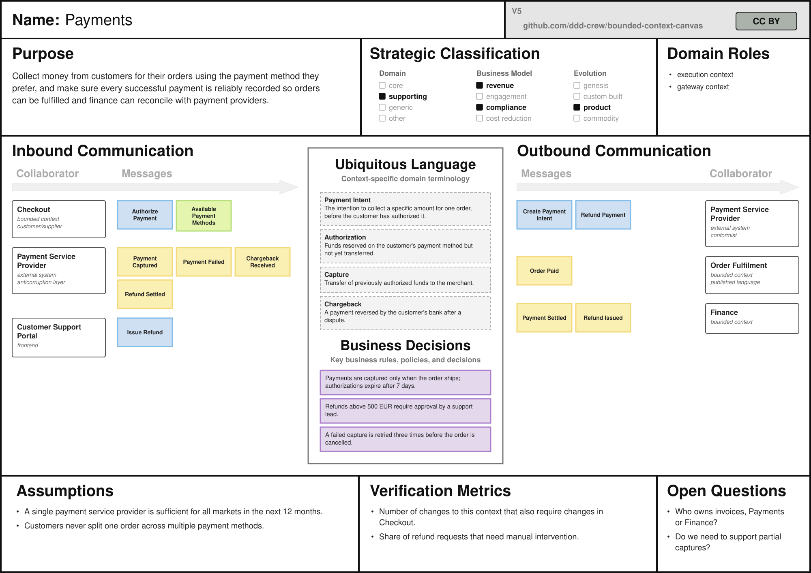

# Bounded Context Canvas as YAML



Describe a bounded context in a YAML file and render it into a Bounded Context Canvas (v5) SVG with [gomplate](https://docs.gomplate.ca). The YAML file is plain text, so it can live next to the bounded context's code, be reviewed in pull requests, and be re-rendered in CI.

## Prerequisites

[Install gomplate](https://docs.gomplate.ca/installing/), e.g. `brew install gomplate`. The template was tested with gomplate v5.2.

## How to

- Copy [`bounded-context-canvas.yaml`](bounded-context-canvas.yaml) and fill it in. [`examples/payments.yaml`](examples/payments.yaml) shows a complete canvas.
- Render it:

  ```sh
  gomplate -d canvas=my-context.yaml -f bounded-context-canvas.svg.tmpl -o my-context.svg
  ```

- Open the SVG in a browser, embed it in your documentation, or convert it to PNG or PDF with any SVG tool.

Only `name` is required. Empty sections are rendered with the canvas' guidance text and placeholder stickies, so a file containing only a name produces a blank canvas.

## Format

| Key | Content |
| --- | --- |
| `name` | Name of the bounded context |
| `purpose` | Purpose from a business perspective |
| `strategic_classification` | `domain`, `business_model`, and `evolution`, each a single value or a list; selected values are highlighted |
| `domain_roles` | List of roles, e.g. `execution context` |
| `inbound_communication` / `outbound_communication` | List of collaborators, each with `collaborator`, optional `type` and `relationship`, and `messages` (`type`: `command`, `query`, or `event`, plus `name`) |
| `ubiquitous_language` | List of `term` with an optional `definition`, or just terms |
| `business_decisions`, `assumptions`, `verification_metrics`, `open_questions` | Lists of text |

[`bounded-context-canvas.schema.json`](bounded-context-canvas.schema.json) is a JSON Schema for the format. Editors using the [YAML language server](https://github.com/redhat-developer/yaml-language-server) (e.g. VS Code with the Red Hat YAML extension) pick it up through the `# yaml-language-server: $schema=...` comment at the top of the starter file for validation and autocompletion. The comment points to the schema on GitHub, so it keeps working after you copy the file into your own repository.

The template checks the input as well and stops with an error that names the problem, for example:

```
canvas: top level: unknown key "ubiquitous_langauge", expected one of [name purpose ...]
canvas: inbound_communication[0].messages[1] (Payment Failed): unknown type "evnt", expected one of [command query event]
```

## Notes

- SVG has no automatic text wrapping, so the template wraps text using approximate Helvetica/Arial glyph widths. Words that are wider than their box, and text without spaces (e.g. Chinese or Japanese), are broken between characters. Other fonts may fit slightly differently.
- A name that is too long for the header is drawn smaller.
- Sections grow to fit their content, so a canvas with many collaborators or terms becomes taller than the printed canvas.
