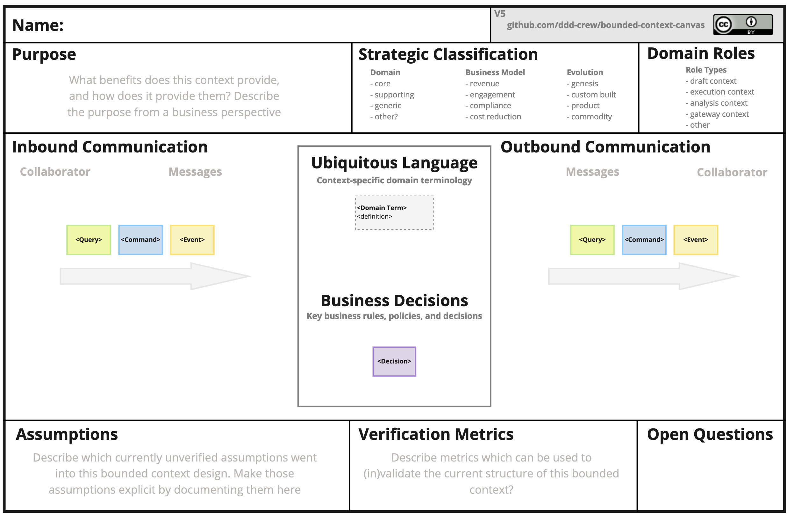
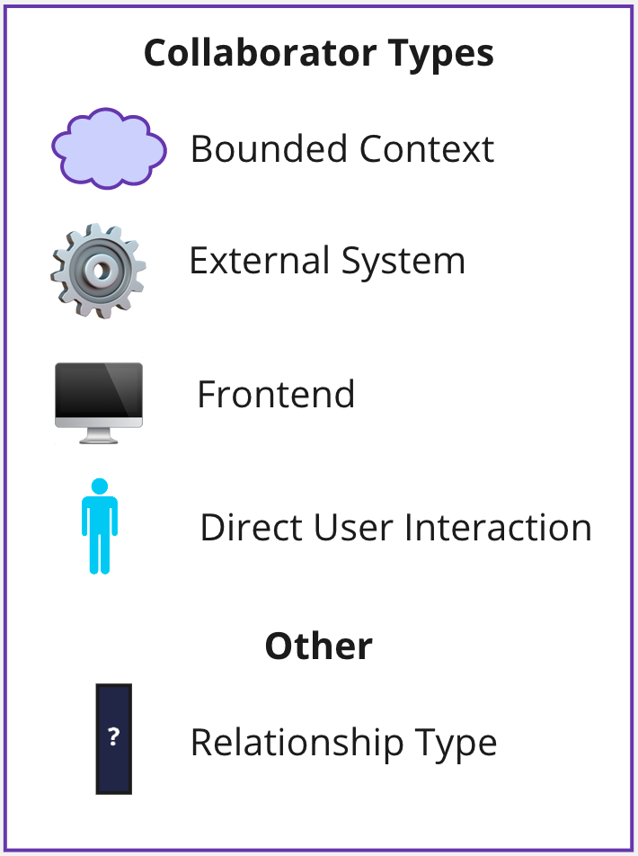
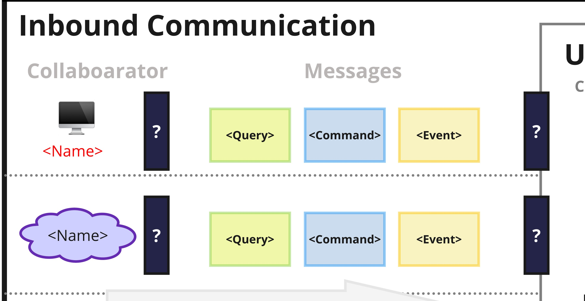
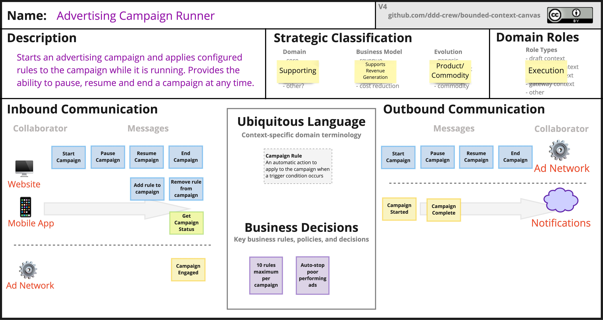

# Bounded Context Canvas

> **Nota sobre a localização:** esta tradução textual corresponde ao **Bounded Context Canvas v5**. Os recursos portugueses já existentes em [`translations/pt/resources`](../pt/resources) permanecem disponíveis e não são modificados por esta contribuição. As imagens, os modelos e os recursos editáveis reutilizados abaixo são os originais da versão v5 e permanecem em inglês. Na primeira ocorrência de um rótulo relevante, o termo original é apresentado em itálico entre parênteses para facilitar a correspondência com esses materiais.

O **Bounded Context Canvas** é uma ferramenta colaborativa para projetar e documentar o design de um único contexto delimitado (*Bounded Context*).

Caso você ainda não tenha familiaridade com o conceito de contexto delimitado, consulte o [DDD Reference](https://www.domainlanguage.com/ddd/reference/), de Eric Evans, e o [artigo de Martin Fowler](https://martinfowler.com/bliki/BoundedContext.html).

O canvas orienta o processo de design de um contexto delimitado ao exigir que o time considere e faça escolhas sobre os principais elementos desse design: desde o nome e as responsabilidades até sua interface pública e suas dependências.

Baixe o [modelo em branco do canvas](../../resources/bounded-context-canvas-5v-blank.jpg).

## Sumário

- [Como usar](#como-usar)
- [Definições das seções](#definições-das-seções)
- [Exemplo](#exemplo)
- [Ferramentas](#ferramentas)
- [Dicas de design](#dicas-de-design)
- [Recursos adicionais](#recursos-adicionais)
- [Traduções](#traduções)
- [Colaboradores](#colaboradores)
- [Contribuições e feedback](#contribuições-e-feedback)

## Como usar

> Para começar rapidamente com o Bounded Context Canvas, preencha o canvas na ordem em que as seções aparecem em [Definições das seções](#definições-das-seções).

Comece pelo nome e pela descrição do contexto para esclarecer, em uma ou duas frases, por que ele existe e quais são suas principais responsabilidades. Depois, as demais seções podem ser preenchidas em qualquer ordem. É possível projetar de fora para dentro, começando pela comunicação de entrada, ou de dentro para fora, começando pelas regras de negócio e pela linguagem do domínio.

Talvez você ainda não possua todas as informações necessárias para completar determinadas seções. Nesse caso, será preciso utilizar outras técnicas de modelagem para descobrir o que falta.

### Formatos alternativos

O formato padrão do Bounded Context Canvas apresentado acima não é o único possível. Também existem outras abordagens, e você pode experimentar formatos novos.

- [Raias de casos de uso (*Use Case Swimlanes*)](https://medium.com/nick-tune-tech-strategy-blog/bounded-context-canvas-recipe-use-case-swimlanes-11ca647175d3): esse formato organiza a seção de comunicação em raias que mostram a sequência das interações: *mensagem recebida* → *decisão ou decisões tomadas* → *mensagem ou mensagens enviadas*.

## Definições das seções

A seguir, uma breve explicação de cada seção do canvas.

### Nome (*Name*)

Dar nomes é difícil. Registrar o nome do contexto e chegar a um acordo com o time ajuda a definir como o contexto será projetado.

### Propósito (*Purpose*)

Algumas frases que descrevem, na linguagem do negócio, por que o contexto existe e o que ele faz. Não inclua detalhes técnicos nesta seção.

Registrar o propósito obriga o time a articular claramente ideias ainda imprecisas e ajuda a garantir que todas as pessoas compartilhem o mesmo entendimento.

Descreva o propósito pela perspectiva do negócio. Também é possível identificar os principais atores para os quais o contexto delimitado gera valor.

### Classificação estratégica (*Strategic Classification*)

Qual é a importância desse contexto para o sucesso da organização?

- **domínio principal (*core domain*):** uma iniciativa estratégica essencial;
- **domínio de suporte (*supporting domain*):** necessário, mas não representa um diferencial;
- **domínio genérico (*generic domain*):** uma capacidade comum encontrada em muitos domínios.

Qual papel o contexto desempenha no modelo de negócio?

- **gerador de receita (*revenue generator*):** as pessoas pagam diretamente por ele;
- **gerador de engajamento (*engagement creator*):** os usuários valorizam a capacidade, mas não pagam diretamente por ela;
- **garantidor de conformidade (*compliance enforcer*):** protege a reputação e a continuidade do negócio.

Qual é o estágio de evolução do conceito? Consulte [Wardley Maps](https://medium.com/wardleymaps).

- **gênese (*genesis*):** domínio novo e ainda pouco explorado;
- **construído sob medida (*custom built*):** as empresas estão criando suas próprias versões;
- **produto (*product*):** existem soluções prontas, mas ainda com diferenciação;
- **commodity:** existem soluções altamente padronizadas.

> Para descrições detalhadas de gênese, construído sob medida, produto e commodity, consulte as [definições de evolução dos Wardley Maps](https://twitter.com/swardley/status/989211014485901316/photo/1).

Para obter ajuda ao preencher essa seção, consulte o [Core Domain Charts](https://github.com/ddd-crew/core-domain-charts).

### Papéis do domínio (*Domain Roles*)

Como o comportamento desse contexto delimitado pode ser caracterizado? Ele recebe grandes volumes de dados e os processa para gerar informações — um contexto de análise? Ou aplica e controla um fluxo de trabalho — um contexto de execução? Identificar os diferentes papéis desempenhados por um contexto ajuda a evitar o acoplamento indevido de responsabilidades.

Para aprofundar essa análise, consulte os [Arquétipos de Contextos Delimitados (*Bounded Context Archetypes*)](https://medium.com/@cyrillemartraire/collaborative-construction-by-alberto-brandolini-an-archetype-of-bounded-contexts-bea640bbb5b), de Alberto Brandolini, e os [Estereótipos de Papéis de Objetos (*Object Role Stereotypes*)](http://www.wirfs-brock.com/PDFs/A_Brief-Tour-of-RDD.pdf), de Rebecca Wirfs-Brock. A [planilha de características do modelo (*Model Traits worksheet*)](../../resources/model-traits-worksheet.md) contém exemplos de papéis gerados pela comunidade — “características do modelo” era o nome anterior de “papéis do domínio”.

### Comunicação de entrada (*Inbound Communication*)

A comunicação de entrada representa colaborações iniciadas por outros colaboradores.

#### Mensagens (*Messages*)

Mensagens são as informações enviadas por um colaborador a outro. Existem três tipos de conversa que podem ocorrer entre contextos delimitados:

- uma solicitação para fazer algo — um **comando**;
- uma solicitação de informação — uma **consulta**;
- uma notificação de que algo aconteceu — um **evento**.

A palavra “mensagem” é usada em sentido geral e não está vinculada a uma implementação específica. Não é obrigatório utilizar um barramento de mensagens nem um fluxo assíncrono. Um comando, por exemplo, pode ser simplesmente o envio de dados de um formulário HTML por meio de uma requisição HTTP POST.

#### Colaboradores (*Collaborators*)

Colaboradores são outros sistemas ou subsistemas que enviam mensagens para esse contexto. Podem ser outros contextos delimitados, front-ends web ou móveis, entre outras possibilidades.

Quando o contexto delimitado é responsável pela interface do usuário — por exemplo, em um [micro-front-end](https://martinfowler.com/articles/micro-frontends.html) —, o tipo de colaborador é uma interação direta com o usuário.

#### Tipo de relacionamento (*Relationship Type*)

O tipo de relacionamento entre dois contextos delimitados indica como seus modelos e times influenciam uns aos outros. Consulte [Context Mapping](https://github.com/ddd-crew/context-mapping) para conhecer esses tipos de relacionamento.

#### Organização em raias (*Organising Into Swimlanes*)

Os colaboradores podem ser organizados em raias horizontais que mostram as mensagens enviadas por cada um.

### Comunicação de saída (*Outbound Communication*)

A comunicação de saída representa as colaborações iniciadas por esse contexto para interagir com outros colaboradores. Aplicam-se os mesmos tipos de mensagem e as mesmas notações da comunicação de entrada.

### Linguagem ubíqua (*Ubiquitous Language*)

Quais são os principais termos do domínio existentes dentro desse contexto e o que significam?

### Decisões de negócio (*Business Decisions*)

Quais são as principais regras e políticas de negócio dentro desse contexto?

### Premissas (*Assumptions*)

Decisões de design nunca são tomadas com conhecimento completo sobre tudo o que existe no domínio. Grande parte do design se baseia em premissas, e é altamente recomendável torná-las explícitas. Essa seção do Bounded Context Canvas é destinada a esse registro.

### Métricas de verificação (*Verification Metrics*)

Domain-Driven Design adota uma abordagem iterativa de modelagem e design baseada em aprendizado contínuo. Métricas podem fornecer informações valiosas para esse aprendizado — pense no ciclo construir, medir e aprender (*build-measure-learn*).

Defina métricas que permitam ao time aprender se os limites escolhidos para o contexto delimitado são adequados ou precisam ser ajustados.

Essas métricas podem ser coletadas, por exemplo, a partir de:

- ambientes de CI/CD;
- ferramentas como Jira;
- sistemas em produção.

### Perguntas em aberto (*Open Questions*)

Quando surgirem perguntas que ninguém presente no workshop consiga responder, registre-as nesta seção. Isso evita que questões importantes sejam perdidas e também oferece um indicador visual do grau de certeza do time sobre o design do contexto delimitado. Uma grande quantidade de perguntas pode indicar um nível elevado de incerteza.

## Exemplo

Abaixo está uma versão preenchida do Bounded Context Canvas.

## Ferramentas

As ferramentas abaixo podem ajudar no uso do Bounded Context Canvas.

### Versão do DDD Toolbox

Uma [ferramenta on-line gratuita e de código aberto para o Bounded Context Canvas](https://dddtoolbox.com/bounded-context-canvas), com editor interativo. O [código-fonte está disponível no GitHub](https://github.com/poulainpi/ddd-toolbox).

### Versão HTML

Uma [versão HTML do canvas](../../tools/html-version/README.md), que pode ser editada no navegador e versionada no controle de código-fonte junto com o sistema. Contribuição de [Nelson da Costa](https://github.com/baruica).

### Versão para Miro

Um [modelo gratuito do Bounded Context Canvas no Miroverse](https://miro.com/miroverse/category/newly-added/the-bounded-context-canvas).

Atualmente, o modelo disponível no Miroverse ainda está na v4. Enquanto isso, é possível baixar neste repositório o [backup do quadro do Miro correspondente à v5](../../resources/bounded-context-canvas-v5-miro.rtb).

### Versão para Draw.io

Um [modelo do canvas para Draw.io](../../tools/drawio-svg-version/README.md), contendo o Bounded Context Canvas como template.

### Versão para Excalidraw

Um [modelo do canvas para Excalidraw](../../tools/excalidraw-version/README.md), contendo o Bounded Context Canvas como template.

### Versão para Lucidchart

Um [modelo do canvas para Lucidchart](../../tools/lucid-version/README.md), contendo o Bounded Context Canvas como template.

## Dicas de design

Ao tornar visíveis no canvas os elementos importantes do design de um contexto delimitado, torna-se mais fácil questionar e aprimorar esse design. As orientações a seguir podem ajudar nesse processo.

> Contribuições com novas dicas por meio de pull requests são bem-vindas.

### Dicas gerais

1. Experimente mover um elemento do canvas para outro contexto. Como essa mudança afeta o design?

### Dicas para o design da interface

A interface pública de um contexto delimitado é seu contrato com o restante do sistema. Contratos exercem grande impacto sobre os colaboradores e são difíceis de alterar; portanto, um bom design é essencial.

Use as perguntas abaixo para avaliar criticamente a interface de um contexto delimitado:

1. Os nomes das mensagens são coerentes entre si e com a descrição do contexto?
2. O tipo de cada mensagem é o mais adequado? Por exemplo, um comando deveria ser um evento?
3. A interface é grande demais, com muitos tipos diferentes de mensagem?
4. O contexto está expondo detalhes internos em excesso?
5. Alguma mensagem parece pertencer a outro lugar?

## Recursos adicionais

- [Bounded Context Canvas V3: Simplifications and Additions](https://medium.com/nick-tune-tech-strategy-blog/bounded-context-canvas-v2-simplifications-and-additions-229ed35f825f)
- [Extending the Bounded Context Canvas with BDD Examples](https://xebia.com/blog/extending-the-bounded-context-canvas-with-bdd-examples/)

## Traduções

- [Recursos em francês](../fr/resources)
- [Recursos visuais existentes em português](../pt/resources)
- [Documentação original em inglês](../../README.md)

## Colaboradores

Agradecemos a todos os [colaboradores atuais e futuros](https://github.com/ddd-crew/bounded-context-canvas/graphs/contributors) e às seguintes pessoas, que contribuíram para o Bounded Context Canvas:

- [Kenny Baas](https://github.com/Baasie)
- [Kim Lindhard](https://github.com/kim-lindhard-dfds)
- [Michael Plöd](https://github.com/mploed)
- [Maxime Sanglan-Charlier](https://twitter.com/__maxs__)

O [Business Model Canvas](https://www.strategyzer.com/canvas/business-model-canvas) foi uma inspiração importante para o Bounded Context Canvas.

## Contribuições e feedback

O Bounded Context Canvas está disponível gratuitamente para uso. Comentários e ideias para aprimorar o canvas ou criar novas versões são bem-vindos.

Você também pode enviar um pull request com exemplos ou novas traduções.

[![CC BY 4.0][cc-by-shield]][cc-by]

Este trabalho está licenciado sob a [Licença Internacional Creative Commons Atribuição 4.0][cc-by].

[![CC BY 4.0][cc-by-image]][cc-by]

[cc-by]: http://creativecommons.org/licenses/by/4.0/
[cc-by-image]: https://i.creativecommons.org/l/by/4.0/88x31.png
[cc-by-shield]: https://img.shields.io/badge/License-CC%20BY%204.0-lightgrey.svg
